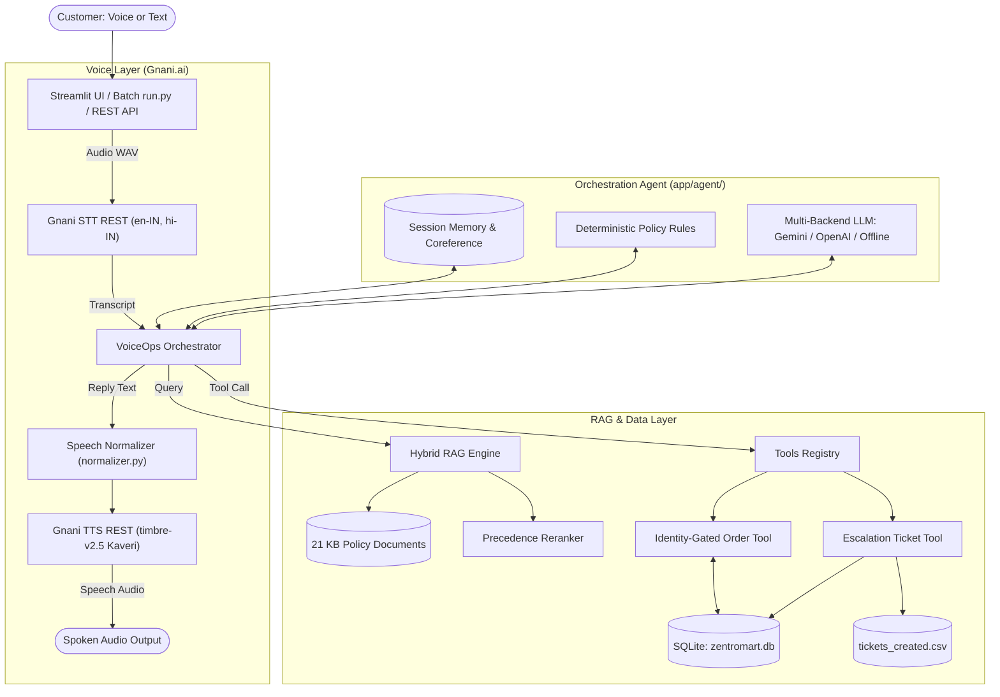
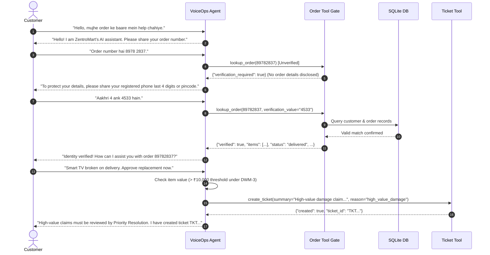
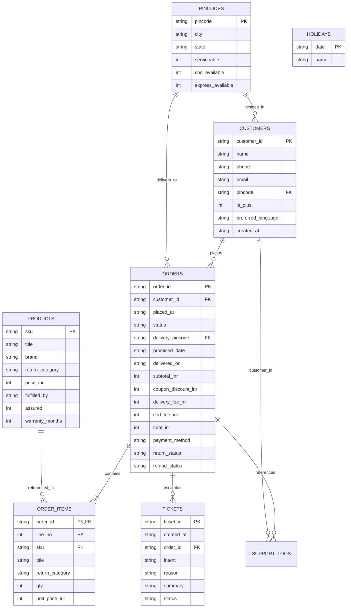

# VoiceOps 2026 — Architecture & System Design

## 1. Architectural Overview

---

## 2. Multi-Turn Caller Verification Flow

---

## 3. Database Entity Relationship Diagram

---

## 4. Key Security & Safety Guarantees
1. **Stateless Verification Gate**: Private customer order information is never returned until either the last 4 digits of the caller's registered phone number or the 6-digit delivery pincode is verified against the database.
2. **Session Memory Isolation**: Each conversation is keyed by a unique `conversation_id`. State, cached tokens, and verified orders never leak across sessions.
3. **Strict Policy Precedence**: Documents are ranked by legal and operational precedence (`policy` > `agent_guide` > `help` > `faq` > `marketing`), preventing outdated or generic marketing copy from overriding binding rules.
4. **No Model SQL/Code Execution**: All database operations use parameterized queries via dedicated repository functions. The LLM never writes or executes arbitrary code or SQL.
